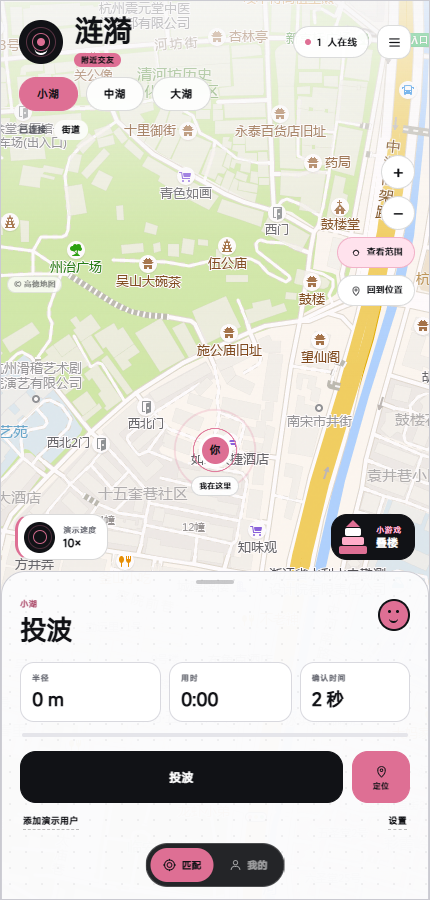
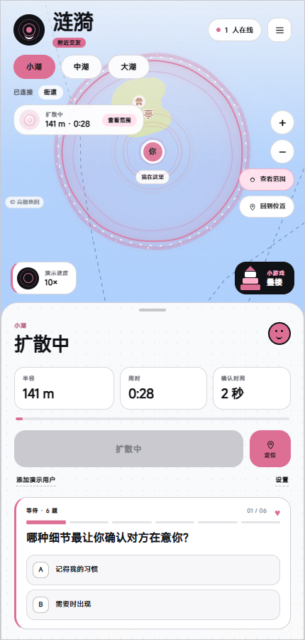
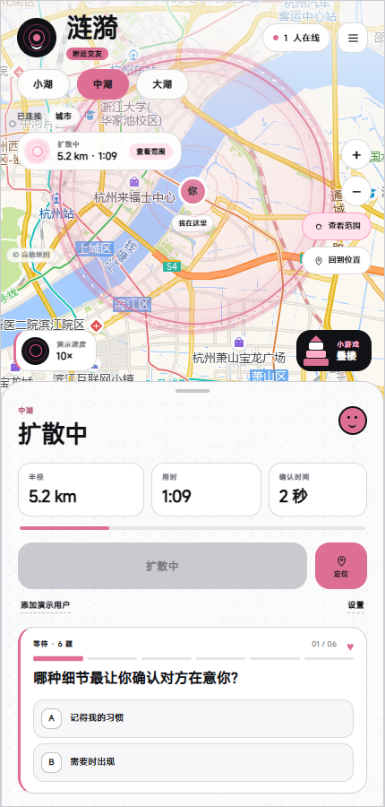
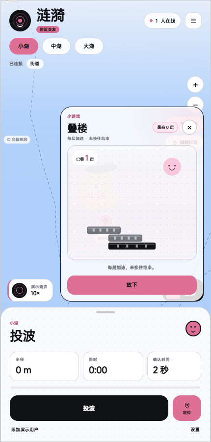
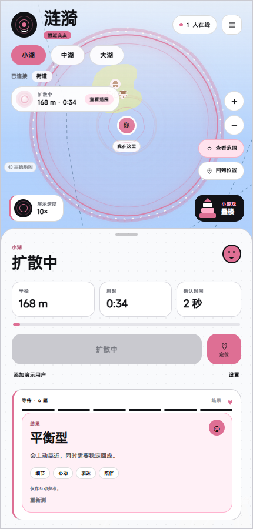
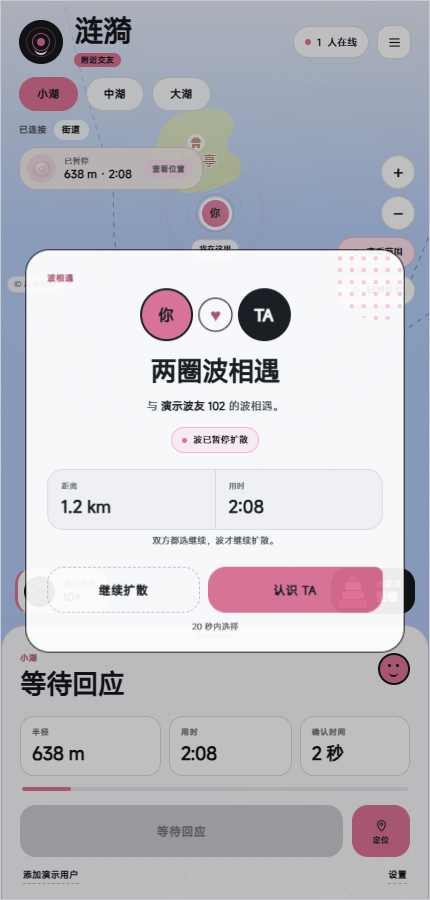
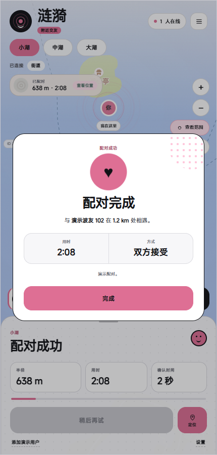

# 涟漪 · Ripple

> 按下“投波”，在真实城市的某个位置留下一圈波前。  
> 波会以固定速度向外扩散，直到与另一圈波相遇。

一个可以直接运行的**异步地理交友 Demo**。它不要求两个人同时在线，也不靠毫秒级抢答制造竞争；两圈波真正接触之后，双方才会进入 20 秒确认。确认结果决定这次相遇是配对、继续扩散，还是停在这里。
















## 这个 Demo 验证了什么

- **真实地理关系**：浏览器定位会转换成平面坐标，波前、距离和时间都由服务端权威计算。
- **异步但可观察的相遇**：玩家不同时在线也可以相遇，客户端只负责把服务端的物理状态平滑外推成动画。
- **秒级公平竞争**：服务端每 2 个模拟秒集中检查一次候选波，同一批候选中随机打散，避免先到 1 毫秒的人永远赢。
- **明确的相遇状态机**：接触冻结、20 秒确认、双方接受配对、双方跳过续波、单方跳过停止、超时和断线停止。
- **轻量交友界面**：街道级地图、波前距离与时间、可缩放的完整波纹、答完六题后生成的关系侧写，以及不伪造距离的演示波友。
- **双一级页面**：底部小导航与手机左右滑动在匹配和我的之间切换；个人主页展示演示人物的头像、基本资料、兴趣标签和动态。
- **等待时的小游戏**：右下角常驻“叠楼”，半透明面板贴着地图，越叠越快、没有层数上限。冷黑、灰白和粉色贯穿界面，按钮与卡片保持平面、无阴影。
- **可自动化验证**：双客户端配对、双客户端继续、选择不一致停止，以及移动端完整交互都有测试。

> 这是一次人机协作开发实践：把“波纹碰到一起就是缘分”这种模糊的产品直觉，拆成可计算、可恢复、可测试的状态机，再用自动化测试守住规则。它适合展示 AI 辅助下的产品拆解、全栈实现和验证闭环，但项目本身不包含大模型推理。

## 核心流程

1. 玩家点击“投波”。
2. 服务端记录起点与起始时间，按该湖面的分段速度计算波前半径。
3. 客户端根据 `simNow` 在本地做时间外推，让波纹连续扩散，不等待每一次网络状态包。
4. 两圈波的波前接触时，服务端立即冻结双方波前，并创建一次相遇。
5. 相遇弹窗显示真实距离、波前时间和相遇点；无论最终是否配对，两圈波默认都停在这里。
6. 双方在 20 秒内各自选择：
   - **都选“认识 TA”**：产生配对，双方收到同一个 `matchId`。
   - **都选“继续扩散”**：两圈波从冻结半径继续扩散，并把彼此加入绕行名单。
   - **一方继续扩散、一方认识**：没有配对，波停止。
   - **超时或断线**：波停止，不再向外扩张。
7. 配对完成后有 30 个模拟秒冷却，避免连续刷匹配。

## 三种湖面

| 玩法 | 最大半径 | 传播规则 | 静默区 | 在线要求 |
| --- | --- | --- | --- | --- |
| 小湖 | 5 km | 5 m/s | 忽略 1 km 内 | 必须保持页面在线 |
| 中湖 | 20 km | 前 50 秒 100 m/s 冲出 5 km，之后 10 m/s | 忽略 5 km 内 | 必须保持页面在线 |
| 大湖 | 200 km（Demo 上限） | 10 m/s | 忽略 50 km 内 | 可以退出，波继续存在 |

补充规则：

- 每个用户在每个湖面同时只能有一圈活跃的波。
- 小湖和中湖断开连接后，活跃波立即失效。
- 大湖允许退出，波会保留到匹配、自然结束或清理。
- 中湖前 50 个模拟秒禁止配对。
- 中湖波前在 5 km 内为黑色，越过 5 km 后切换为粉色；颜色只表示阶段，不改变速度或配对判定。
- 主界面左下角固定提供 `1× / 2× / 5× / 10×` 演示速度选择；默认 `×10`，最高 `×10`。它只影响演示时间，不改变波速、距离和相遇判定；`×1` 就是真实时间。

## 相遇条件

设两圈波的起点距离为 `d`，当前半径分别为 `rA`、`rB`：

- 两圈波还没有互相穿过：`d > |rA - rB|`
- 波前已经接触或重叠：`d <= rA + rB`
- 同时距离大于该湖面的静默区

服务端每 50 ms 推进一次模拟时钟，每 2 个模拟秒检查一轮候选。接触发生后，两圈波冻结在当前半径，不会在等待确认期间继续向外传播。

## 地图与界面

- 默认手机视口停留在街道级视角，优先展示已传播距离、波前时间和确认窗口。
- 底图保留真实道路与水面颜色，不使用灰阶或饱和度滤镜。
- 界面文案只保留状态、参数和操作结果，不使用拟人化旁白或装饰性解说。
- 波纹使用独立 Canvas 绘制：不规则水纹边缘、半透明水体、泡沫亮片和多层内侧回波会随波前一起扩散；相遇后整组水纹立即冻结。
- 点击地图上的波状态胶囊或“查看范围”，可以缩放查看完整波纹。
- 相遇后，地图会同时画出双方冻结的波前，并在真实相遇点留下脉冲标记。
- 等待传播时按顺序完成 6 个轻量情感问题，每题有即时反馈；六题结束后会根据回答生成“主动型 / 平衡型 / 慢热型”的结果标签和关键词，不声称是心理诊断。
- 左下角常驻演示速度按钮，右下角常驻“叠楼”小游戏入口；楼越高移动越快，没有高度上限，镜头会跟随最新楼层，最高层数保存在浏览器本地。
- 演示波友会在身份标签中明确标注“演示波友”，不会伪装成真实的远方用户；它的波圈与玩家使用同一套逐帧半径计算，扩散速度一致。

底图使用高德地图的公开栅格瓦片，并在浏览器内完成 WGS84 到 GCJ-02 的显示坐标转换。瓦片来自外部服务：

- 网络较慢时会显示“地图未加载，配对正常”，波的传播和配对仍正常计算。
- 这个 Demo 没有配置商业地图 SDK Key；正式上线应使用有授权的官方地图 SDK，并遵守服务条款。
- 地图请求会暴露当前视口附近的位置范围；真实产品需要位置模糊化、权限管理、隐私合规和更严格的最小化采集。

## 真实定位

页面上的“定位”按钮会调用浏览器 Geolocation API：

- 第一份上报的坐标会成为本地平面原点。
- 后续坐标使用球面到局部平面的近似转换，计算东向/北向米数。
- 浏览器显示层会做 WGS84 到 GCJ-02 的偏移修正，避免定位点落在错误街区。
- 浏览器通常只允许 `localhost` 或 HTTPS 页面读取定位；通过局域网 IP 访问时，需要 HTTPS 或在“玩法与设置”中手动调整位置。
- 位置只发送到当前 Demo 的本地 WebSocket 服务，不做账号绑定或持久化。

## 技术架构

```text
Browser
  ├─ Leaflet 地图 / 波纹 Circle / 定位与缩放
  ├─ 本地按服务端 simNow 外推波前半径
  ├─ 相遇点、双方冻结波前和情感问答
  └─ WebSocket 双向消息
          │
          ▼
Node.js HTTP + ws
  ├─ 每 50 ms 推进全局模拟时钟
  ├─ 服务端权威半径、分段速度与生命周期
  ├─ 2 秒候选窗口、随机打散、原子锁定
  ├─ 20 秒确认状态机与双人跳过续波
  ├─ 三种湖面规则和断线语义
  └─ 每 100 ms 广播状态快照
```

### 目录

```text
wave-demo/
├─ server.js                  # HTTP、WebSocket、物理、相遇状态机
├─ public/
│  ├─ index.html              # 手机端页面结构
│  ├─ style.css               # 冷黑粉轻交友视觉与波纹动画
│  ├─ app.js                  # Leaflet、定位、波纹外推、交互
│  └─ vendor/leaflet/         # 本地 Leaflet 资源
├─ tests/
│  ├─ match-flow.js           # 双方接受 -> 配对
│  ├─ skip-flow.js            # 双方跳过 -> 续波且不配对
│  ├─ stop-flow.js            # 一方接受一方跳过 -> 停止
│  └─ ui-flow.js              # 定位、10×、叠楼、六题结果、相遇与配对
├─ docs/                      # README 截图
└─ package.json
```

## 运行

需要 Node.js 18+。

```bash
npm install
npm start
```

打开 [http://localhost:3000](http://localhost:3000)。

新增页面文件：

- `public/profile.css`：个人主页与底部导航样式
- `public/avatar-linwan.svg`：演示人物头像
- `public/moment-city.svg`、`moment-coffee.svg`、`moment-trail.svg`：动态配图
- `tests/screen-flow.js`：双页面、导航与滑动切换测试

### 单窗口体验

1. 点击“定位”让地图来到当前街区，或直接使用默认的杭州西湖演示位置。
2. 点击“放一个演示波友”。
3. 点击“投波”。
4. 观察波前距离增长；如果波纹超出当前视野，点击左上角的距离胶囊或右侧“查看范围”。
5. 在等待时点右下角“叠楼”，点击“放下这一层”或按空格/点击游戏画面继续叠楼。
6. 相遇后选择“认识 TA”或“继续扩散”。

切换页面：点击底部我的，或从匹配页向左滑，查看个人主页；从资料页向右滑返回匹配。

演示波友会自动复制玩家的选择，方便单窗口完整走完配对或续波流程；它的坐标同样参与真实的波前计算。

### 双窗口体验

1. 打开两个浏览器窗口，都进入 `http://localhost:3000`。
2. 先让第一台设备读取定位，第二台再读取；当前 Demo 以第一份定位作为本地平面原点。
3. 也可以在“玩法与设置”里手动把位置拖到同一片区域。
4. 两个窗口分别投波。
5. 相遇后测试“双方接受”“双方继续”和“一方接受一方继续”三种分支。

## 测试

先启动服务，再执行：

```bash
npm test
```

它会依次运行三个服务端流程：

- `match-flow.js`：两个 WebSocket 客户端投波并都选择接受，验证双方收到同一个配对结果。
- `skip-flow.js`：双方都选择继续，验证双方收到 `outcome: "continue"`、波恢复为活跃状态，并且不会立刻再次相遇。
- `stop-flow.js`：一方继续、一方接受，验证双方收到 `outcome: "missed"`、波停止且没有配对。

浏览器端完整流程需要本机安装 Chrome 或 Edge：

```bash
npm run test:ui
```

测试会模拟移动端定位、10× 演示速度、叠楼落层、六题结果、投波、相遇弹窗、接受和配对弹窗，并检查页面没有运行时异常。

浏览器端测试还会检查底部导航、页面左右滑动和资料页滚动区域。

## 当前边界

这是一个“机制可玩、可验证、界面完整”的 Demo，不是生产交友产品。尚未包含：

- 登录、账号体系、跨设备身份和实名认证
- 数据库持久化（服务重启后用户、波和相遇会重置）
- 每日投波额度、风控、反作弊和高峰期限流
- 聊天、举报、拉黑、内容审核和安全提示
- 生产级地图授权、坐标加密和合规存储
- 多进程/多机部署下的共享状态与空间索引
- 推送通知、离线配对结果领取和弱网消息补偿

演示波友是测试工具，不是模拟真实用户的数据源；它不会伪造远方玩家，也不会伪造距离。

## 可以继续做什么

- 用 Redis/PostGIS 做跨进程波状态和空间索引
- 引入每日额度、冷却时间、频率限制和高峰分流
- 把“2 秒候选窗口”和“20 秒确认窗口”做成可配置策略
- 接入聊天、举报、拉黑与内容审核
- 增加弱网重连、离线大湖波和推送通知
- 用真实设备、多城市坐标和地图 SDK 验证定位精度

---

如果这个 Demo 对你有帮助，可以先从双设备定位、候选窗口策略或双方继续后的绕行规则开始扩展。
